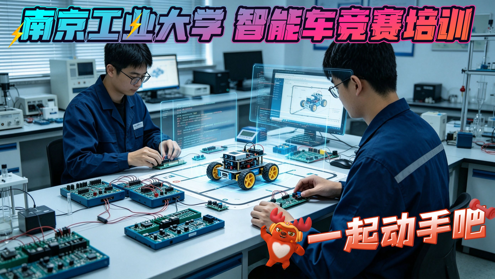
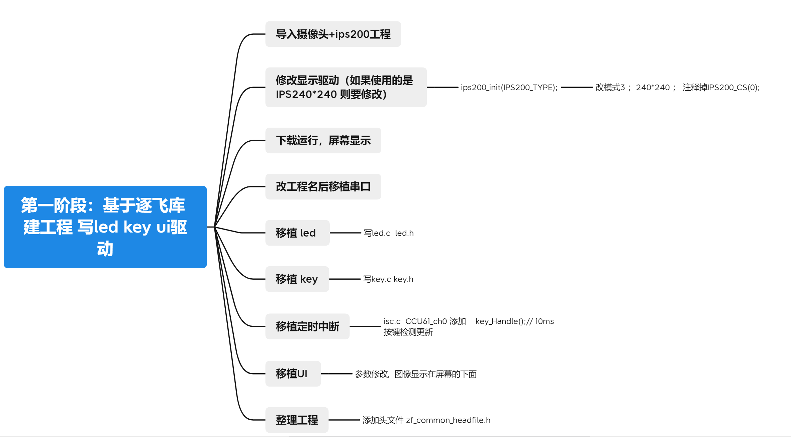
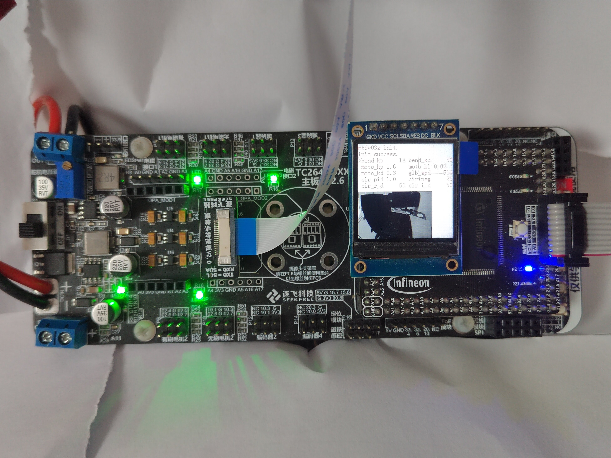
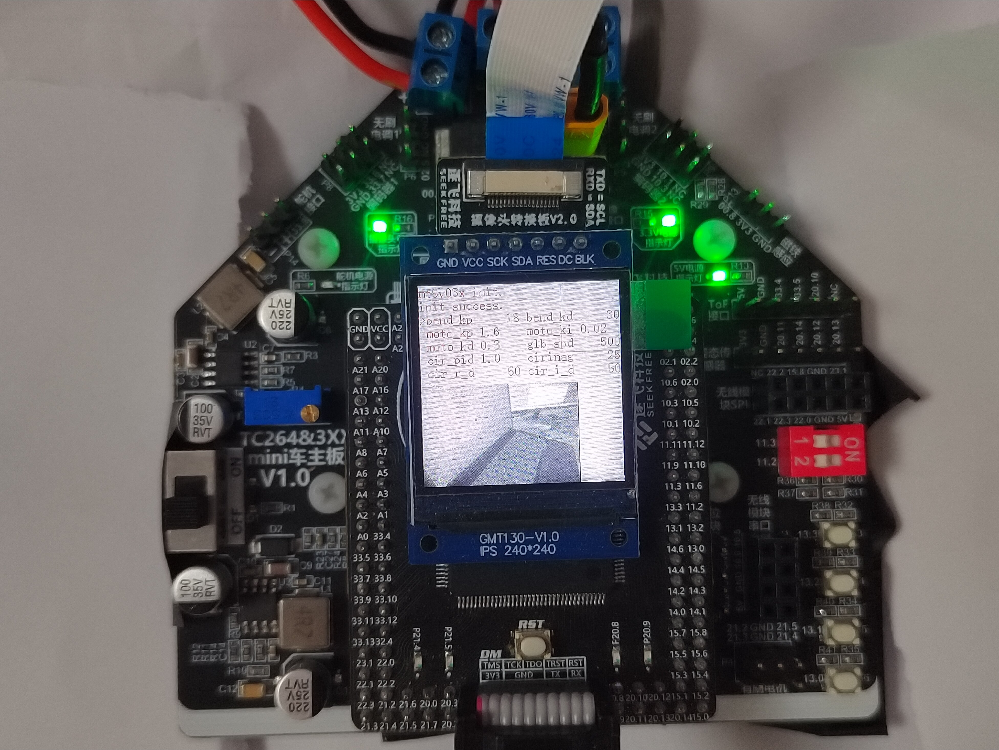
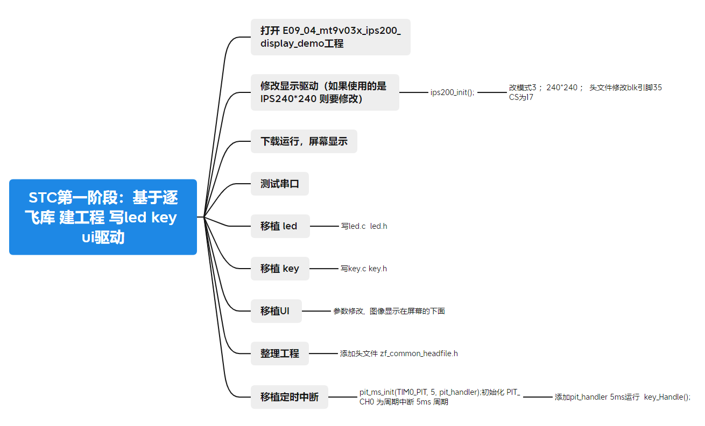
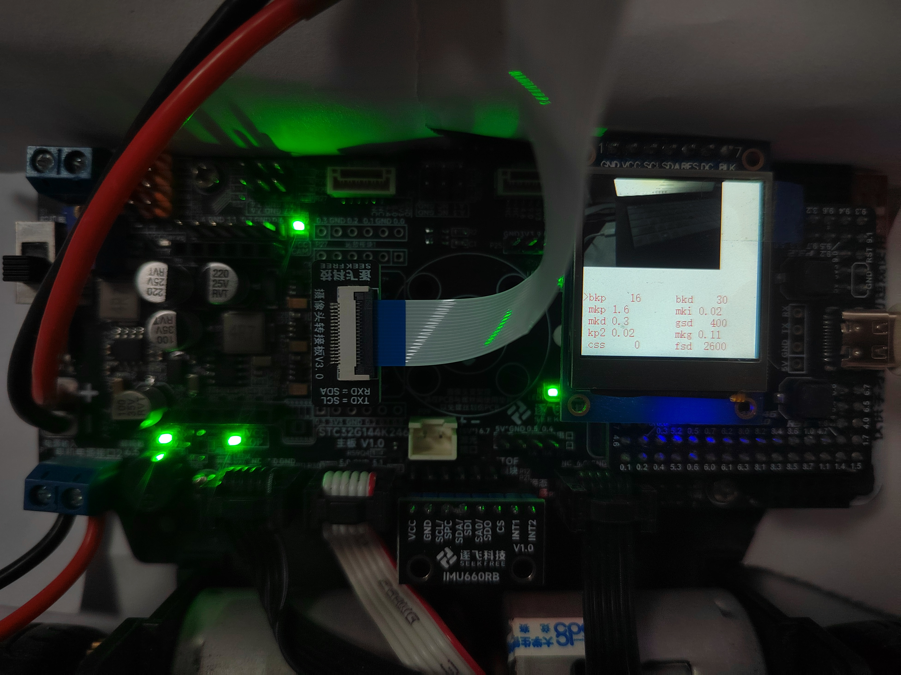
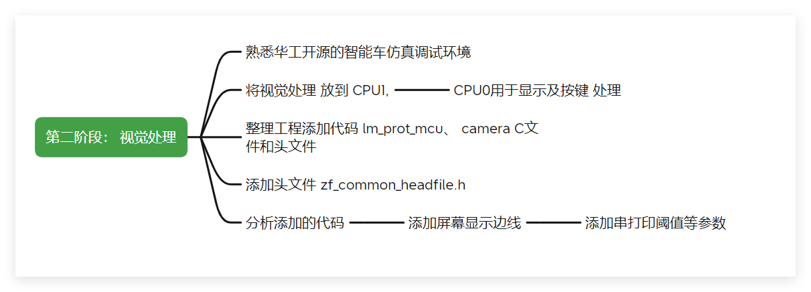
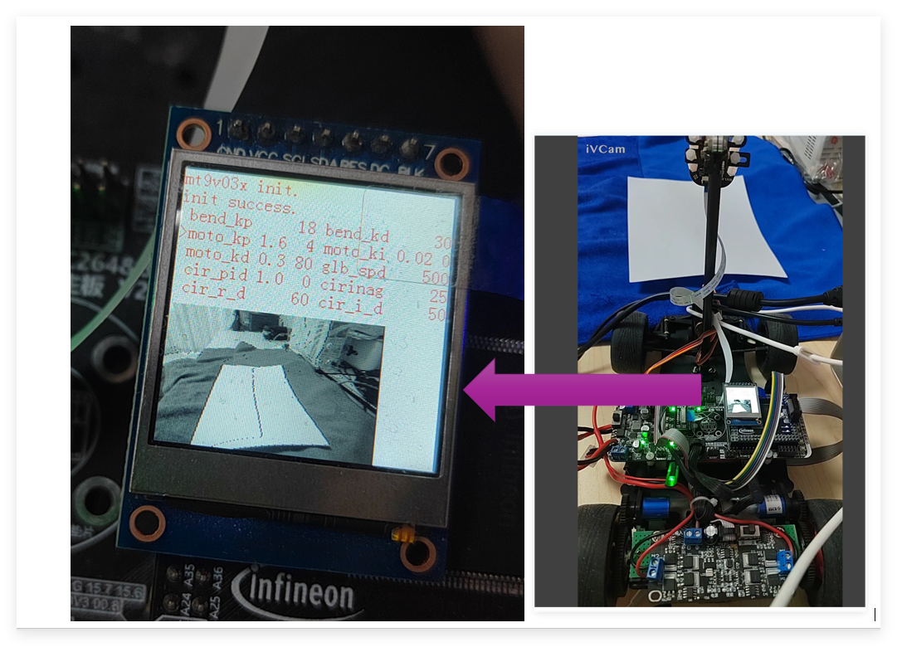

# smartcar_njtech

基于逐飞infineon库的智能车校内赛开源代码。

## smartcar_fourwheel_njtech
传统车硬件采用 TC264核心板V3.4.1+TC264_主板_V2.6.2.1+方向1024编码器+IPS240*240+总钻风摄像头

## smartcar_micro_njtech
缩微车硬件采用 TC264核心板V3.4.1+TC264_mini车主板_V1.0+方向1024编码器+IPS240*240+总钻风摄像头

## smartcar_fourwheel_njtech-stc

传统车硬件采用 STC32G144K246核心板+STC32G144K246_主板+方向1024编码器+IPS240*240+总钻风摄像头

## 

- ## 第一阶段 10.1-10.13 

**搭建**   英飞凌 主板 +核心板+显示屏 + 下载器
1、 跟着开源代码 跑通 所有的例程 ，自学ADS ，能够下载程序，运行和调试自己缩写的代码
2、能够自己编写驱动 ： 点灯、按键 、显示 ，并运行成功

该阶段 2 个 板的代码相同（注意：infineon 四轮与缩微 按键 引脚不同，即key.c 中的 key1~key4定义不同）

**搭建**   STC 主板 +核心板+显示屏 + USB下载线

- ## 第二阶段 10.14-10.31

**已经搭建的 + 摄像头** 
3、 跟着开源代码 编写 视觉处理程序，编写 图像的驱动 ，能够完成赛道图像的巡中线，屏幕上显示中线偏差

[[开源\]22招新碎碎念—智能车视觉仿真调试环境与使用教程_哔哩哔哩_bilibili](https://www.bilibili.com/video/BV1XNaH6cE9R?spm_id_from=333.788.videopod.sections&vd_source=71db2148932a21bb8dece7cd24f9dd38)

 [22招新碎碎念-竞速组视觉入门_哔哩哔哩_bilibili](https://www.bilibili.com/video/BV1QFHJ68EBp?spm_id_from=333.788.videopod.sections&vd_source=71db2148932a21bb8dece7cd24f9dd38)

使用第一视角 视频 （https://www.bilibili.com/video/BV1vh4y157sB/?spm_id_from=333.337.search-card.all.click&vd_source=71db2148932a21bb8dece7cd24f9dd38） **自行裁剪图片**

感谢华工开源的智能车仿真调试环境

运行结果 

- ## 第三阶段 11.1-11.7

**已经搭建的 + imu** 
4、 跟着开源代码程 编写 惯性测量程序，编写 imu 的驱动 ，屏幕上显示欧拉角度

**原理** - 惯导更新与卡尔曼滤波处理

[爱捣鼓的码农视频专辑-爱捣鼓的码农视频合集-哔哩哔哩视频](https://space.bilibili.com/515017956/lists)

**代码 -** 基于逐飞库的惯性导航适用于TC和CYT

[惯性导航开源喽~_哔哩哔哩_bilibili](https://www.bilibili.com/video/BV1rui9BkEnc/?spm_id_from=333.337.search-card.all.click&vd_source=71db2148932a21bb8dece7cd24f9dd38)

 编码器惯性导航胎教版使用教程.  https://gitee.com/Emma321/navigation

- ## 第四阶段11.8-11.15

**已经搭建的 + 车模（包括电机及电机驱动 + 舵机 + 编码器）**
5、 跟着开源代码教程 编写 编码器测量程序，编写编码器的驱动 ,测量小车速度
6、 跟着开源代码编写 舵机程序，编写舵机的驱动 
7、 跟着开源代码编写 电机控制程序，编写电机的驱动 

**全部搭建完成** 后：车速闭环控制
8、跟着开源代码编写 基于小车速度的 电机闭环控制
9、基于中线偏差巡线开环控制舵机

- ## 第五阶段 11.15-11.25

**全部搭建完成** 后：转向和车速的闭环控制
10、跟着开源代码编写 基于视觉巡线的 舵机转向闭环控制
11、添加巡线时舵机控制的同时，进行车速控制
12、基于路径进行速度规划